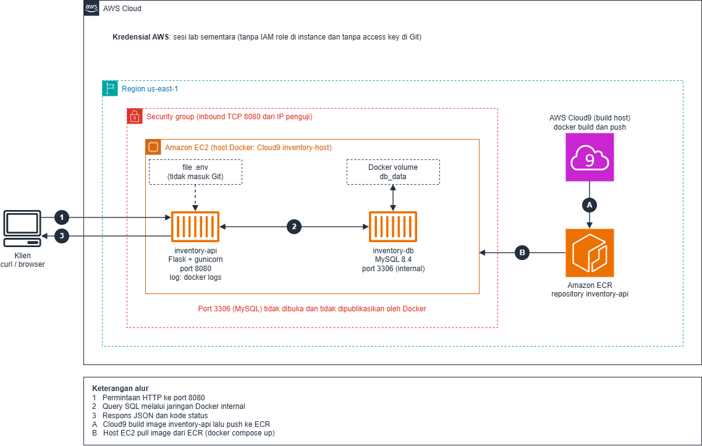

# Inventory API (Track B: EC2, Docker, dan ECR)

Tugas individu Cloud Computing, Week 12: Design & AWS Setup (dilanjutkan pada Week 14: Final Submission).

- **Use Case:** Inventory
- **Track:** B (EC2 + Docker + ECR)
- **Nama:** Zahra Elfatima
- **NIU:** 535709

Proyek ini merupakan API CRUD sederhana untuk satu entity yaitu **Item**. Aplikasi berjalan di satu instance **Amazon EC2** (dibuat melalui **AWS Cloud9**) menggunakan **Docker Compose** dengan dua container, yaitu `inventory-api` (Flask dan gunicorn) dan `inventory-db` (MySQL 8.4). Image `inventory-api` dibangun sendiri dari Dockerfile di Cloud9 lalu disimpan di **Amazon ECR**. Pengerjaan dilakukan di lab *Building Microservices and a CI/CD Pipeline with AWS* pada AWS Academy.

## Arsitektur


Seluruh resource dibuat di region **us-east-1**. Diagram arsitektur tersedia di folder `docs/`, yaitu `architecture-diagram.png`. Instance EC2 host dibuat melalui Cloud9 karena peluncuran instance langsung dari halaman EC2 ditolak oleh lab (`ec2:RunInstances` tidak diizinkan).

### Pembagian Layanan

Track B mensyaratkan dua layanan terencana dan satu Docker image yang dibangun sendiri.

| Layanan | Image | Fungsi |
|---|---|---|
| `inventory-api` | Dibangun sendiri dari `src/Dockerfile` dan disimpan di Amazon ECR | Menerima request HTTP, memeriksa input, dan menjalankan operasi CRUD. |
| `inventory-db` | Image resmi `mysql:8.4` | Menyimpan data Item pada Docker volume `db_data` sehingga data tetap ada setelah container dijalankan ulang. |

## Entity: Item

Proyek ini menggunakan satu entity, yaitu `Item`, yang disimpan pada tabel `items` di MySQL.

| Atribut | Tipe Data | Aturan |
|---|---|---|
| `id` | Teks | Dibuat otomatis oleh server (UUID versi 4) dan tidak diisi oleh klien. |
| `name` | Teks | Wajib diisi, tidak boleh kosong, maksimal 255 karakter. |
| `category` | Teks | Wajib diisi, tidak boleh kosong, maksimal 255 karakter. |
| `quantity` | Bilangan bulat | Wajib diisi dengan nilai minimal 0. |
| `location` | Teks | Wajib diisi, tidak boleh kosong, maksimal 255 karakter. |
| `updated_at` | Teks (waktu ISO, UTC) | Dibuat otomatis oleh server setiap data dibuat atau diubah. |

## Endpoint API

API menyediakan empat operasi CRUD untuk mengelola data Item.

| Aksi | Method dan Path | Body | Respons Sukses | Respons Gagal |
|---|---|---|---|---|
| Create | `POST /items` | JSON: `name`, `category`, `quantity`, `location` | 201 dan Item yang dibuat | 400 |
| Read | `GET /items/{id}` | Tidak ada | 200 dan Item | 400, 404 |
| Update | `PUT /items/{id}` | JSON: `name`, `category`, `quantity`, `location` | 200 dan Item setelah diubah | 400, 404 |
| Delete | `DELETE /items/{id}` | Tidak ada | 200 dan pesan `Item dihapus` | 400, 404 |

Aturan lainnya:

1. `PUT` mengganti seluruh isi Item sehingga keempat field wajib dikirim ulang.
2. ID yang mengandung karakter selain huruf, angka, dan tanda hubung, atau lebih dari 64 karakter, menghasilkan `400`.
3. Method lain pada path yang sudah dikenal menghasilkan `405`, sedangkan path yang tidak dikenal menghasilkan `404`.
4. Seluruh respons berupa JSON. Pesan galat berbentuk `{"error": "..."}`.
5. Endpoint tambahan `GET /health` memeriksa koneksi aplikasi ke database. Endpoint ini menghasilkan `200` jika database terjangkau dan `503` jika tidak. Endpoint ini tidak termasuk empat endpoint CRUD.

## Struktur Repository

```text
.
├── README.md
├── docker-compose.yml          # Dua layanan: inventory-api dan inventory-db
├── .env.example                # Contoh konfigurasi (file .env tidak ikut Git)
├── .gitattributes
├── .gitignore
├── src/
│   ├── app.py                  # Aplikasi Flask (endpoint CRUD)
│   ├── db.py                   # Koneksi dan pembuatan tabel MySQL
│   ├── wsgi.py                 # Titik masuk gunicorn
│   ├── requirements.txt
│   ├── Dockerfile
│   └── .dockerignore
├── scripts/
│   └── smoke-test.sh           # Tes CRUD otomatis dengan curl
├── docs/
│   ├── design-brief.pdf        # Design brief
│   └── architecture-diagram.png
├── evidence/                   # Tangkapan layar bukti AWS dan pengujian
└── archive/
    └── track-c/                # Pengerjaan Track C sebelumnya (arsip)
```

Folder `archive/track-c/` berisi pengerjaan awal menggunakan Track C di AWS Academy ACF Sandbox. Folder ini disimpan sebagai arsip dan tidak dipakai pada Track B.

## Deployment Plan

Deployment dilakukan di lab *Building Microservices and a CI/CD Pipeline with AWS*. Ada dua environment Cloud9. Environment pertama (**build host**) dipakai untuk membangun dan mengunggah image. Environment kedua bernama `inventory-host` (**host**) berjalan sebagai instance EC2 yang menjalankan aplikasi. Ganti `<ACCOUNT_ID>` dengan Account ID AWS dan `<IP_PUBLIK_HOST>` dengan IP publik instance host.

### 1. Memulai Lab

- Buka AWS Academy dan jalankan lab hingga statusnya aktif.
- Buka AWS Console dan pastikan region yang dipakai adalah **us-east-1**.

### 2. Membuat Repository ECR

- Buka **Amazon ECR** dan pilih **Create repository**.
- Isi nama repository dengan `inventory-api`.
- Jika muncul galat izin saat membuat tag, buat repository tanpa tag.

### 3. Membuat Environment Cloud9

- Buat environment Cloud9 pertama sebagai build host.
- Buat environment Cloud9 kedua dengan nama `inventory-host` sebagai host aplikasi. Peluncuran instance EC2 langsung ditolak oleh lab, sehingga instance host dibuat melalui Cloud9.
- Catat IP publik instance host dari halaman **EC2**.

### 4. Mengatur Security Group Host

- Buka security group yang dipakai instance `inventory-host` (security group bawaan Cloud9).
- Tambahkan satu aturan inbound: **Custom TCP**, port **8080**, sumber **IP penguji** dalam bentuk `/32`.
- Port 3306 tidak dibuka.

### 5. Menyiapkan Build Host

Docker dan Git sudah tersedia di Cloud9. Ambil kode dan login ke ECR.

```bash
git clone https://github.com/Elfaa-github/cc-inventory.git
cd cc-inventory
aws ecr get-login-password --region us-east-1 | \
  docker login --username AWS --password-stdin <ACCOUNT_ID>.dkr.ecr.us-east-1.amazonaws.com
```

### 6. Membangun dan Mengunggah Image

Perintah `docker compose build` tidak dipakai karena versi buildx di Cloud9 terlalu lama. Image dibangun dengan `docker build`.

```bash
docker build -t <ACCOUNT_ID>.dkr.ecr.us-east-1.amazonaws.com/inventory-api:latest ./src
docker push <ACCOUNT_ID>.dkr.ecr.us-east-1.amazonaws.com/inventory-api:latest
```

Setelah perintah selesai, image `inventory-api` muncul di repository ECR.

### 7. Menyiapkan Host

Perintah pada langkah 7 sampai 11 dijalankan di terminal `inventory-host`. Periksa Docker Compose dengan perintah berikut.

```bash
docker compose version
```

Jika perintah tersebut belum tersedia, pasang plugin Compose.

```bash
sudo mkdir -p /usr/local/lib/docker/cli-plugins
sudo curl -SL https://github.com/docker/compose/releases/latest/download/docker-compose-linux-x86_64 \
  -o /usr/local/lib/docker/cli-plugins/docker-compose
sudo chmod +x /usr/local/lib/docker/cli-plugins/docker-compose
```

### 8. Mengambil Kode dan Mengisi Konfigurasi

```bash
git clone https://github.com/Elfaa-github/cc-inventory.git
cd cc-inventory
cp .env.example .env
nano .env
```

Pada file `.env`, ganti seluruh password dengan nilai yang kuat dan ganti `<ACCOUNT_ID>` pada `API_IMAGE` dengan Account ID AWS. File `.env` tidak boleh di-commit.

| Variabel | Keterangan |
|---|---|
| `DB_NAME` | Nama database. |
| `DB_USER` | User database untuk aplikasi. |
| `DB_PASSWORD` | Password user database. |
| `DB_ROOT_PASSWORD` | Password root MySQL. |
| `API_IMAGE` | Nama image API, sesuai alamat repository ECR. |

### 9. Login ke ECR dan Menjalankan Aplikasi

```bash
aws ecr get-login-password --region us-east-1 | \
  docker login --username AWS --password-stdin <ACCOUNT_ID>.dkr.ecr.us-east-1.amazonaws.com
docker compose up -d
docker compose ps
```

Docker menarik image `inventory-api` dari ECR. Kedua container, yaitu `inventory-api` dan `inventory-db`, harus berstatus berjalan. Container `inventory-api` menunggu `inventory-db` sehat terlebih dahulu.

### 10. Menguji API

Periksa `/health` dari komputer penguji, lalu jalankan tes otomatis.

```bash
curl -i http://<IP_PUBLIK_HOST>:8080/health
./scripts/smoke-test.sh http://<IP_PUBLIK_HOST>:8080
```

Skrip ini memeriksa `/health`, Create, Read, Update, input tidak valid, Delete, dan Read setelah Delete. Skrip berhenti dengan kode 0 jika semua tes lolos. Pengujian manual tersedia pada bagian **Contoh Pengujian API**.

### 11. Memeriksa Persistensi, Pemulihan, dan Log

- **Persistensi data:** buat satu Item, jalankan `docker compose down` (tanpa opsi `-v`), lalu `docker compose up -d`. Ambil Item yang sama dengan `GET /items/{id}`; hasilnya harus `200`.
- **Data di database:** jalankan `docker exec -it inventory-db sh -c 'mysql -u"$MYSQL_USER" -p"$MYSQL_PASSWORD" "$MYSQL_DATABASE" -e "SELECT * FROM items;"'`.
- **Skenario gagal dan pulih:** jalankan `docker stop inventory-db`. Panggilan ke `/health` menghasilkan `503`. Jalankan `docker start inventory-db`, lalu `/health` kembali menghasilkan `200`.
- **Log aplikasi:** jalankan `docker logs inventory-api`.

Perintah `docker compose down -v` menghapus volume `db_data` beserta seluruh data, sehingga tidak dipakai pada pengujian persistensi.

### 12. Pembersihan Resource

Lakukan langkah berikut sebelum pengumpulan.

- Hapus file `.env` dari host atau pastikan file tersebut tidak ada di repository.
- Jalankan `docker compose down` di host.
- Hapus kedua environment Cloud9 (instance EC2 ikut dihentikan) dan pastikan tidak ada instance yang masih berjalan.
- Hapus image di repository ECR jika sudah tidak diperlukan.
- Hapus security group yang tidak terpakai.
- Pastikan tidak ada resource berbayar yang masih berjalan.

## Contoh Pengujian API

Ganti nilai `URL` dengan alamat instance host. Pastikan tidak ada garis miring (`/`) di bagian akhir.

```bash
URL="http://<IP_PUBLIK_HOST>:8080"
```

### 1. Create Item (201 Created)

```bash
curl -i -X POST "$URL/items" -H "Content-Type: application/json" \
  -d '{"name":"Contoh barang","category":"Contoh","quantity":3,"location":"Gudang A"}'
```

### 2. Read Item (200 OK)

```bash
curl -i "$URL/items/ID"
```

Ganti `ID` dengan ID Item yang dihasilkan saat Create.

### 3. Update Item (200 OK)

```bash
curl -i -X PUT "$URL/items/ID" -H "Content-Type: application/json" \
  -d '{"name":"Contoh barang","category":"Contoh","quantity":7,"location":"Gudang A"}'
```

### 4. Input Tidak Valid (400 Bad Request)

Request Create tanpa atribut `category`.

```bash
curl -i -X POST "$URL/items" -H "Content-Type: application/json" \
  -d '{"name":"Contoh barang","quantity":1,"location":"Gudang A"}'
```

Respons yang diharapkan: `{"error": "Field 'category' wajib diisi (teks)"}`.

### 5. Delete Item (200 OK)

```bash
curl -i -X DELETE "$URL/items/ID"
```

### 6. Read Item Setelah Dihapus (404 Not Found)

```bash
curl -i "$URL/items/ID"
```

## Keamanan

- **Security group:** aturan inbound untuk aplikasi hanya TCP 8080 dari IP penguji (`/32`). Port 3306 tidak dibuka. Aturan SSH untuk Cloud9 berasal dari pengaturan bawaan Cloud9.
- **Database:** port MySQL tidak dipublikasikan oleh Docker sehingga hanya container `inventory-api` yang dapat mengaksesnya melalui jaringan internal Docker.
- **Rahasia:** password database disimpan di file `.env` yang diabaikan Git. Repository hanya berisi `.env.example`. Tidak ada access key AWS di repository.
- **Izin AWS:** login, push, dan pull ECR memakai kredensial sesi lab yang bersifat sementara (`aws ecr get-login-password`). Role IAM baru tidak dibuat dan tidak ada access key di repository.
- **Container:** aplikasi berjalan sebagai user non-root di dalam container.

## Keterbatasan

1. **Daftar Item:** API tidak menyediakan endpoint untuk mengambil seluruh Item. Endpoint CRUD yang tersedia hanya empat sesuai ketentuan tugas, sehingga Item hanya dapat diambil berdasarkan `id`.
2. **Satu instance:** aplikasi dan database berjalan di satu instance EC2. Jika instance dihapus atau volume `db_data` dihapus, data ikut hilang.
3. **Tanpa HTTPS dan autentikasi:** API diakses melalui HTTP dan belum memiliki autentikasi. Akses dibatasi hanya melalui security group.
4. **Resource lab:** seluruh resource berada di akun lab sehingga deployment harus dibuat ulang mengikuti langkah di atas jika lab di-reset.
5. **Host melalui Cloud9:** peluncuran instance EC2 langsung ditolak oleh lab (`ec2:RunInstances` tidak diizinkan untuk semua tipe instance), sehingga host dibuat melalui Cloud9. Cloud9 menghentikan instance setelah tidak dipakai beberapa saat, dan IP publiknya dapat berubah saat instance dijalankan kembali.
6. **Tanpa IAM role di instance:** akses ECR memakai kredensial sesi lab yang sementara. Jika sesi lab berakhir, login ke ECR harus diulang.
7. **Build tanpa Compose:** `docker compose build` tidak dipakai karena versi buildx di Cloud9 terlalu lama, sehingga image dibangun dengan `docker build`.

## Bukti Implementasi AWS

Folder `evidence/` berisi tangkapan layar berikut.

| Berkas | Isi |
|---|---|
| `01-lab-aktif.png` | Status lab yang aktif. |
| `02-ecr-repository.png` | Repository ECR `inventory-api`. |
| `03-security-group.png` | Aturan inbound security group (TCP 8080 dari IP penguji). |
| `04-ec2-instance.png` | Instance EC2 host (`inventory-host`) yang berjalan. |
| `05-docker-compose-ps.png` | Dua container berjalan (`docker compose ps`). |
| `05b-health-200-dari-luar.png` | `GET /health` menghasilkan 200 dari komputer penguji (akses dari luar). |
| `06-ecr-image-pushed.png` | Image `inventory-api` di repository ECR. |
| `07-post-201.png` | Hasil `POST /items` dengan status 201. |
| `08-get-200.png` | Hasil `GET /items/{id}` dengan status 200. |
| `09-put-200.png` | Hasil `PUT /items/{id}` dengan status 200. |
| `10-delete-200.png` | Hasil `DELETE /items/{id}` dengan status 200. |
| `11-get-404.png` | Hasil `GET /items/{id}` setelah dihapus dengan status 404. |
| `12-input-salah-400.png` | Hasil `POST /items` tanpa `category` dengan status 400. |
| `13-persistensi-setelah-restart.png` | Item masih ada setelah container dijalankan ulang. |
| `14-recovery-db.png` | `/health` menghasilkan 503 saat database berhenti dan 200 setelah database dijalankan kembali. |
| `15-docker-logs.png` | Log aplikasi dari `docker logs inventory-api`. |
| `16-data-tersimpan-mysql.png` | Isi tabel `items` di MySQL (`SELECT * FROM items`). |
